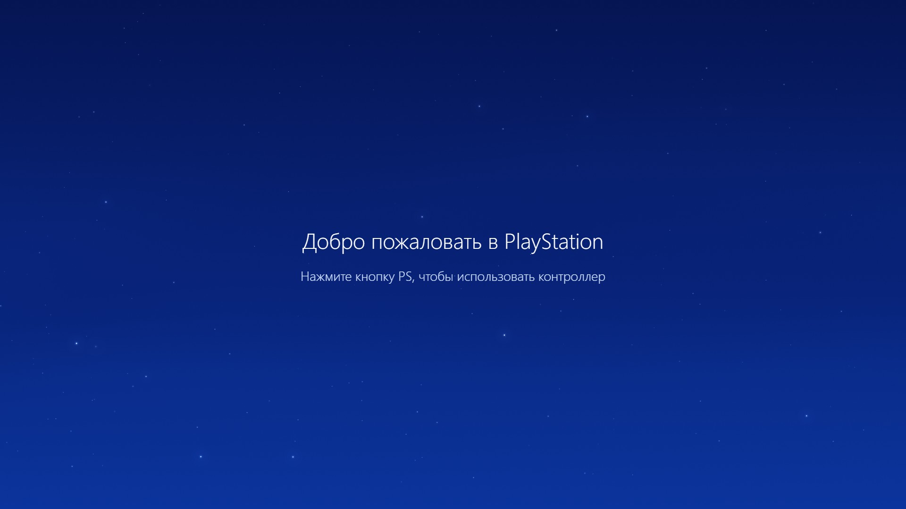
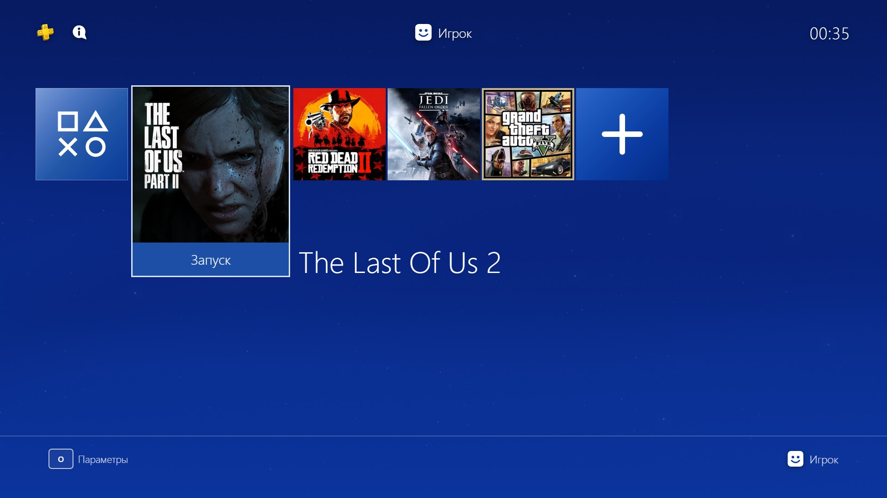
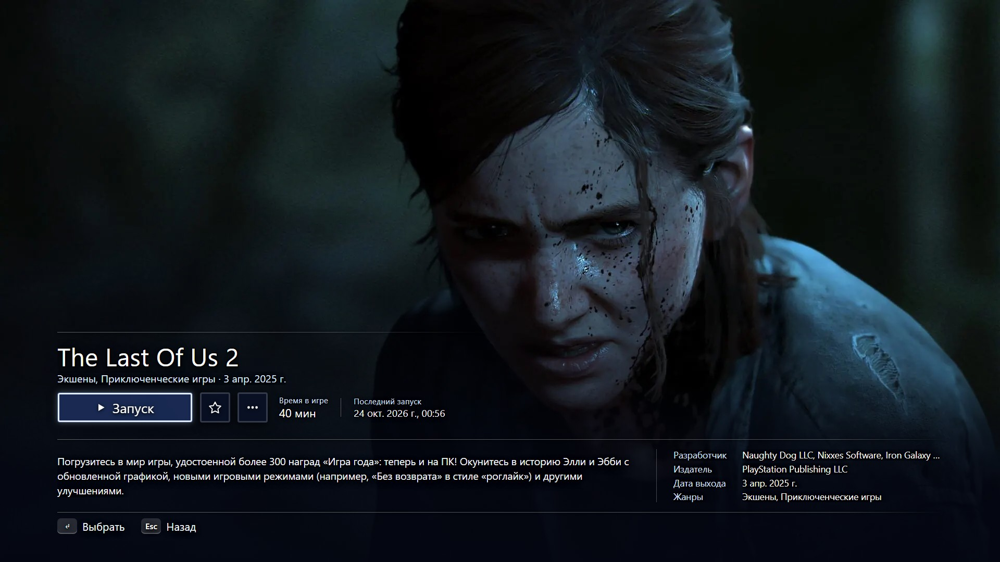
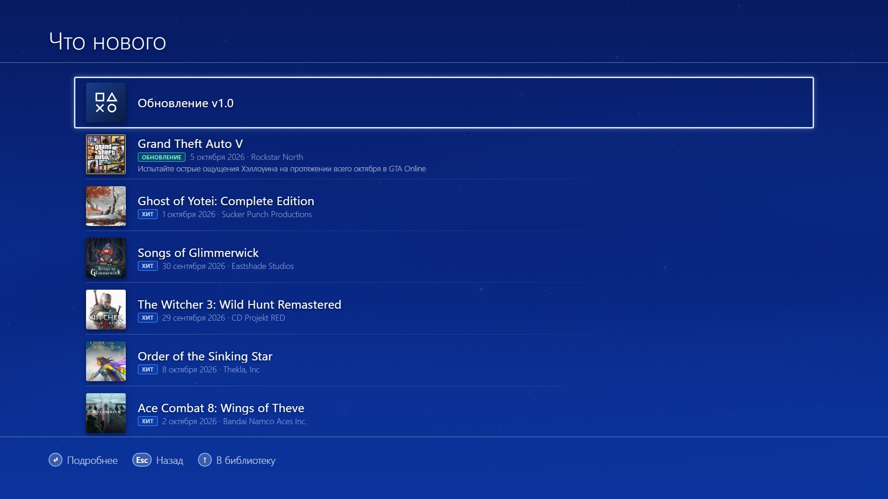
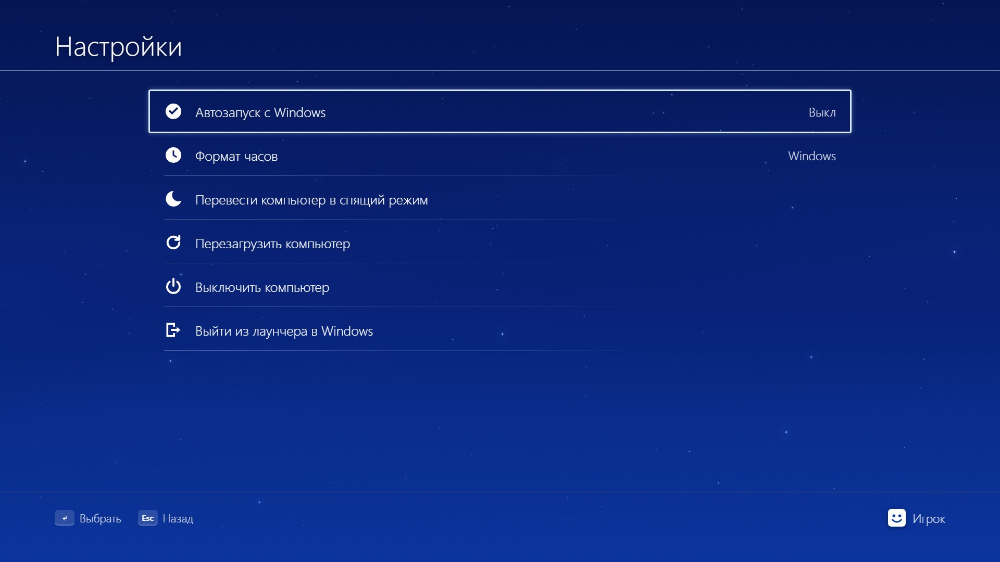

# PS4 Launcher

**Делаю лаунчер игр для Windows в стиле PS4** · **Building a PS4-style game launcher for Windows**

[Русский](#русский) · [English](#english)

| Библиотека | Страница игры |
|:---:|:---:|
|  |  |

| Что нового | Настройки |
|:---:|:---:|
|  |  |

---

## Русский

### О проекте

Делаю лаунчер игр для Windows в стиле PS4. Это личный проект: хочется запускать ПК-игры с дивана, с геймпадом и атмосферой домашнего экрана PlayStation — без эмулятора и без консоли.

Это не эмулятор PS4: лаунчер запускает обычные Windows-игры. Интерфейс и описания игр — на русском.

**Статус:** в разработке. Исходники пока не опубликованы.

### Что уже работает

- **Библиотека в стиле PS4** — горизонтальная карусель, плитки с обложками, запуск игры, избранное, переименование и удаление.
- **Страница игры** — полноэкранный арт, описание, разработчик, издатель, жанры, дата релиза, время в игре и последний запуск.
- **Автоматическое оформление** — обложки из SteamGridDB, фоны и описания из IGDB и Steam; картинки сжимаются в WebP.
- **«Что нового»** — новинки, свежие релизы и обновления установленных игр; описания переводятся на русский.
- **Звук и анимации** — музыка экрана входа и библиотеки, звуки меню, анимация плиток и перехода на страницу игры.
- **Геймпад** — Xbox (XInput) и стандартные геймпады с подсказками кнопок; мышь и клавиатура тоже работают.
- **Фон «Ночное небо»** — Canvas 2D: волны, звёзды, падающие звёзды и варп.
- **Запуск и возврат** — лаунчер следит за окном игры, возвращает фокус после выхода и считает время игры.
- **Настройки** — автозапуск с Windows, формат часов, сон, перезагрузка и выключение ПК.

### Технологии

Python + pywebview (WebView2), HTML/CSS/JS, Canvas 2D. Обложки и метаданные — SteamGridDB, IGDB и Steam. Платформа: Windows 10/11.

### Дисклеймер

Проект не связан с Sony Interactive Entertainment и не одобрен ею. PlayStation — торговая марка Sony. Обложки, арты и звуки принадлежат их правообладателям и используются только для оформления личного некоммерческого проекта.

---

## English

### About

I'm building a PS4-style game launcher for Windows. It's a personal project: playing PC games from the couch, with a gamepad and the feel of the PlayStation home screen — no emulator, no console.

This is not a PS4 emulator: it launches regular Windows games. The interface and game descriptions are currently in Russian.

**Status:** work in progress. Source code is not public yet.

### What works already

- **PS4-style library** — horizontal carousel, cover tiles, launching, favorites, rename and remove.
- **Game page** — full-screen art, description, developer, publisher, genres, release date, play time and last launch.
- **Automatic artwork** — covers from SteamGridDB, backgrounds and descriptions from IGDB and Steam; images are compressed to WebP.
- **What's New** — upcoming releases, recent hits and updates for installed games; descriptions are translated into Russian.
- **Sound and animation** — login and library music, menu SFX, tile and page transitions.
- **Gamepad support** — Xbox (XInput) and standard gamepads with button hints; mouse and keyboard also work.
- **Night-sky background** — Canvas 2D waves, stars, shooting stars and warp.
- **Launch and return** — watches the game window, restores launcher focus after exit and tracks play time.
- **Settings** — start with Windows, clock format, sleep, restart and shut down.

### Tech

Python + pywebview (WebView2), HTML/CSS/JS, Canvas 2D. Artwork and metadata from SteamGridDB, IGDB and Steam. Platform: Windows 10/11.

### Disclaimer

This project is not affiliated with or endorsed by Sony Interactive Entertainment. PlayStation is a trademark of Sony. Game artwork and audio belong to their respective owners and are used only for this personal, non-commercial project.
